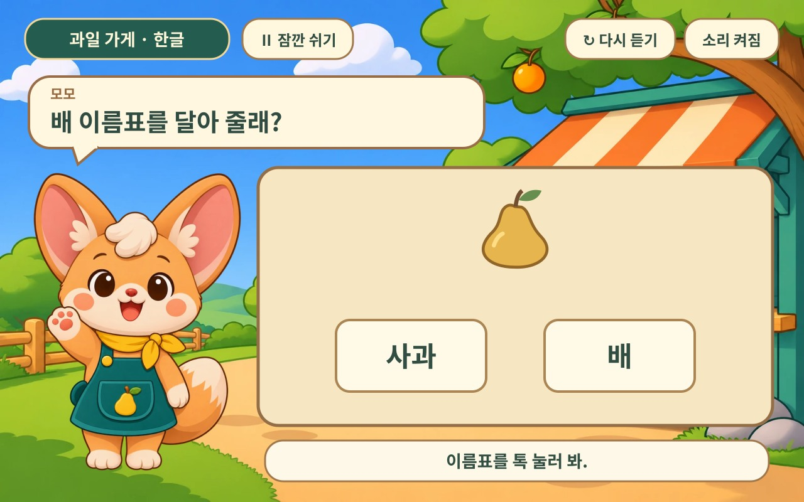
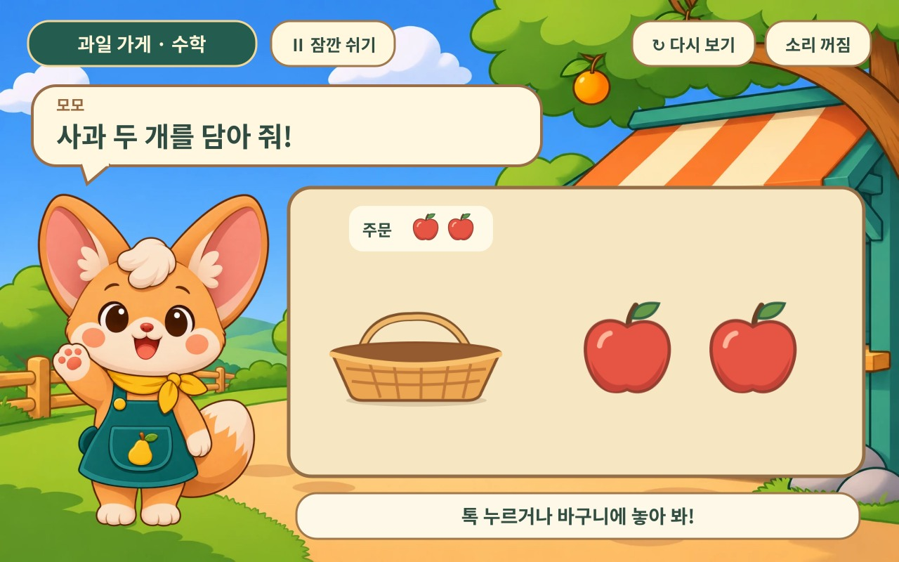
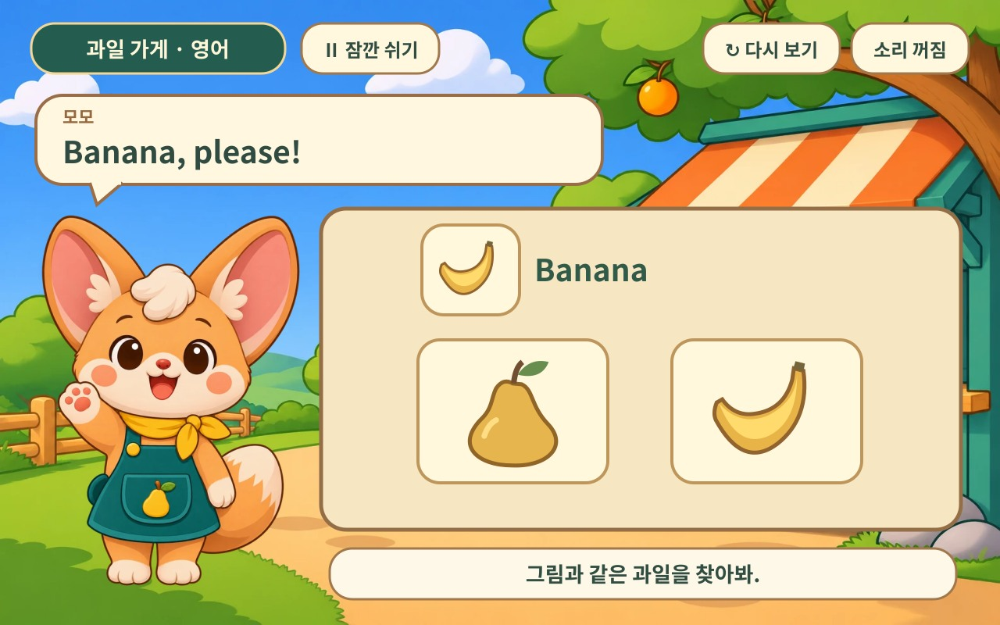
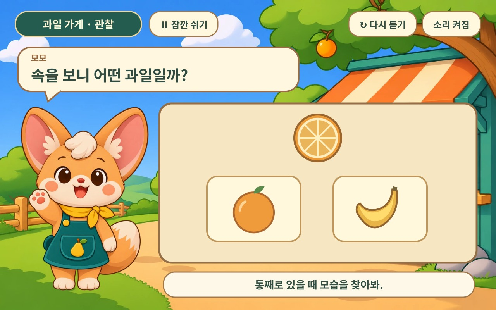
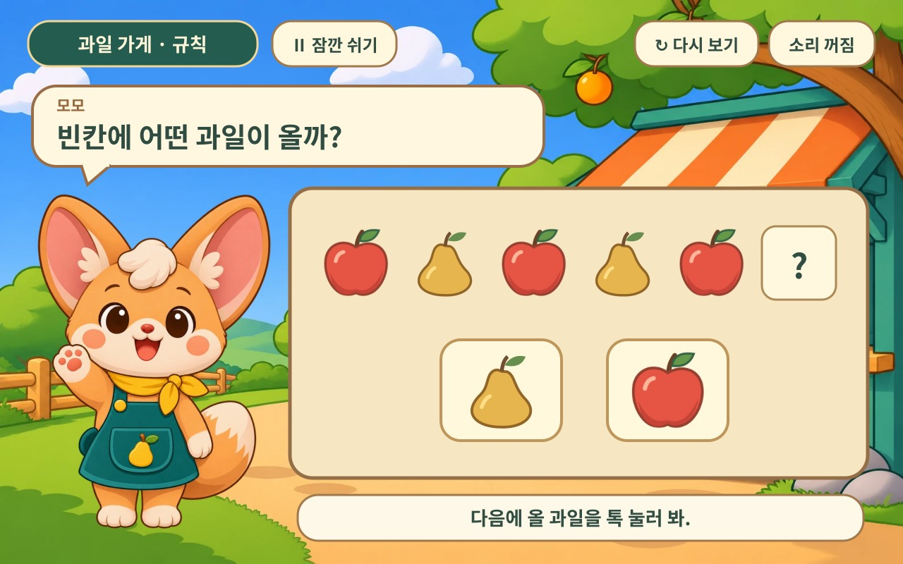
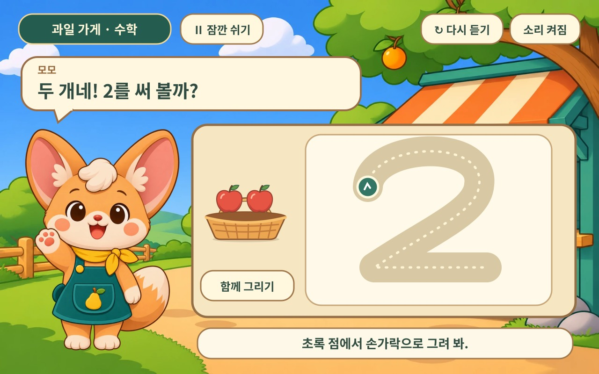

# 과일 가게 첫 한 판 · 여섯 장면 콘티

갤럭시탭 가로 1280×800을 기준으로 한 제작용 화면과 대본이다. 그림은 **만 4세, 앱 소리 켜짐, 아이가 처음 손대기 직전**의 모습이다. 글자 크기·보기 간격·힌트 타이밍은 이 크기로 실기기에서 검토한다. 각 그림을 누르면 크게 볼 수 있다.

| 한글 · 이름표 달기 | 수학 · 두 개 담기 |
| --- | --- |
|  |  |
| **영어 · 주문 듣고 고르기** | **관찰 · 잘린 과일 알아보기** |
|  |  |
| **규칙 · 진열대 이어 놓기** | **수학 대체 · 숫자 2 쓰기** |
|  |  |

## 한 판 운영

시작할 때 모모가 가게 문을 열고 주문표를 꺼낸다. 검토용 순서는 한글 → 수학 → 영어 → 관찰 → 규칙이다. 두 번째 검토에서는 수학 자리에 숫자 2 쓰기를 넣는다. 그때는 이미 사과 두 개가 담긴 바구니로 시작해, 직전 문항이나 담기 조작에 의존하지 않는다. 출시 편성에서는 [반복 방지 규칙](RELEASE_SPEC.md)에 따라 순서를 섞는다.

기본 상태에서는 모모가 주문을 말하고, 다시 듣기를 누르면 같은 주문을 들려준다. 모모의 한 줄 부탁은 말풍선에, 실제로 만질 물건은 오른쪽 작업대에 둔다. 행동은 대사 중에도 시작할 수 있다. 아이가 답하면 물건이 먼저 변하고 모모가 그 결과를 한 문장으로 짚는다. 완료 후 하단 안내 자리에 큰 다음 화살표를 띄운다. 다섯째 장에서는 진열대로 가는 화살표로 바꾸고, 완성한 다섯 주문의 소품을 남긴다. 마지막에 모모가 “오늘 가게 일, 같이 해 줘서 고마워!”라고 인사한다.

**공통 도움.** 첫 시도 전에는 정답 위치를 보여 주지 않는다. 시작 시범은 할 수 있는 동작을 보여 준다. 아이가 직접 누르면 시범은 즉시 멈춘다. 6초간 입력이 없으면 시작할 곳을 한 번 짚고 기다린다. 두 번 시도해도 어려우면 모모가 아래 장면별 단서를 보여 준다. 시범 요청이나 오답에 시간 제한과 감점은 없다. 무음은 같은 말풍선·시범·표정을 유지하고, ‘다시 보기’로 시범을 반복할 수 있다. ‘잠깐 쉬기’에서 계속·다음 주문·동네로 돌아가기를 고를 수 있다. 넘어간 주문과 모모의 도움으로 마친 주문을 구분한다.

## 장면별 대본과 반응

### 한글 · 배 이름표 달기

- **주문과 목표** — 배 그림 아래에 ‘사과’와 ‘배’ 이름표를 놓는다. “배 이름표를 달아 줄래?” 아이가 이름표를 읽거나 들은 이름을 떠올려 ‘배’를 탭하면 과일 앞에 붙는다. 글자 자체가 단서가 되도록 두 이름표의 색과 크기는 같다.
- **무음 시범과 도움** — 빈 이름표의 윤곽이 과일 앞에 나타나 달 위치를 보여 준다. 다른 이름표를 누르면 그 표가 제자리로 내려오고 모모가 “이건 사과야. 배를 찾아볼까?”라고 한다. 다음 도움에서는 두 표에 각각 작은 과일 그림을 펼친다. 그림을 보고 마치면 그림 도움을 사용한 것으로 남긴다.
- **완료** — “배! 이름표가 꼭 맞네.” 말풍선에 ‘배’를 크게 띄우고 과일과 이름표가 함께 한 번 들썩인다.

### 수학 · 사과 두 개 담기

- **주문과 목표** — “사과 두 개를 담아 줘!” 사과 그림 두 개가 있는 주문표, 빈 바구니, 사과 두 개를 보여 준다. 톡 누르면 날아가고, 바구니 근처에 끌어 놓아도 담긴다. 바구니 밖에 놓으면 처음 자리로 돌아온다.
- **무음 시범과 도움** — 반투명 사과가 바구니 쪽으로 한 번 움직인다. 담을 때마다 주문표의 사과 한 칸이 채워진다. 첫 사과가 도착하면 “하나!” 하고, 멈춰 있으면 “사과 하나 더 담아 볼까?”와 함께 남은 한 칸을 강조한다. 시범 사과는 세지 않는다.
- **완료** — 둘째 사과가 닿으면 “둘!”, 이어서 “사과 두 개, 고마워!” 모모가 두 팔을 든다. 같은 사과를 연달아 눌러도 한 개만 담긴다. 0.4의 담기 조작과 녹음 다섯 개를 재사용한다.

### 영어 · 모모의 바나나 주문

- **주문과 목표** — “Banana, please!” 모모가 손을 내밀고 아이는 배와 바나나 중 하나를 탭한다. 유음 첫 시도에서는 바나나 그림을 가린 주문 카드를 보여 준다. 듣고 맞혔을 때만 영어 듣기 활동으로 기록한다.
- **무음 시범과 도움** — 소리를 끄면 주문 카드가 뒤집혀 바나나 그림과 Banana가 보인다. 큰 그림 둘 중 같은 과일을 찾는다. 유음에서도 다른 과일을 고르면 모모가 “Banana”를 한 번 더 말하고 카드를 펼친다. 그림이 드러난 뒤에는 소리를 다시 켜도 그림 도움으로 기록한다. 기기 음량이 0이어도 카드의 뒤집기 손짓을 따라 누르면 그림을 볼 수 있다.
- **완료** — 바나나가 모모의 손으로 이동한다. “A banana! Thank you!” 완성 카드에 그림과 영어 단어가 함께 남는다.

### 관찰 · 속을 보고 오렌지 찾기

- **주문과 목표** — “속을 보니 어떤 과일일까?” 단면의 둥근 테두리와 방사형 조각을 크게 보여 준다. 아이는 통오렌지와 바나나 중에서 고른다. 보기 둘의 크기와 배경색을 같게 해 물건의 모양을 볼 수 있게 한다.
- **무음 시범과 도움** — 단면이 살짝 돌아갔다 멈춘다. 다른 과일을 고르면 “바깥 모양도 볼까?”와 함께 단면 뒤로 둥근 껍질 일부가 보인다. 추가 도움에서는 단면과 껍질이 닫히는 모습을 천천히 보여 준다.
- **완료** — 두 반쪽이 붙어 통오렌지가 된다. “동그란 오렌지였네!” 다시 갈랐다 붙이는 동작을 한 번 보여 주고 멈춘다.

### 규칙 · 사과와 배 진열하기

- **주문과 목표** — “빈칸에 어떤 과일이 올까?” 진열대에 사과·배·사과·배·사과·빈칸이 있다. 아래의 배를 탭하거나 빈칸 근처에 놓으면 줄이 완성된다.
- **무음 시범과 도움** — 모모가 왼쪽부터 한 칸씩 짚고 빈칸에서 손을 뗀다. 사과를 놓으면 다시 내려오고, “사과, 배. 사과, 배. 그다음은?”과 함께 두 칸씩 받침이 차례로 올라온다. 소리가 없어도 짝의 경계가 보인다.
- **완료** — “사과 다음엔 배!” 완성된 세 쌍이 왼쪽부터 한 번씩 들썩인다. 다음 판에는 같은 규칙의 시작 과일이나 규칙의 종류를 바꾼다.

### 대체 수학 · 주문표에 숫자 2 쓰기

- **주문과 목표** — 사과 두 개가 바구니에 보인다. 모모가 하나씩 짚고 “두 개네! 2를 써 볼까?”라고 한다. 오른쪽에는 굵은 숫자 길과 큰 시작점을 보여 준다. 움직이는 점이 위쪽 곡선 → 왼쪽 아래 → 오른쪽 끝 순서로 한 번 지나간다. 아이는 시범 도중에도 그릴 수 있다.
- **입력과 도움** — 시작점에 손을 대면 손끝을 따라 길에 잉크가 찬다. 위 곡선, 내려오는 구간, 마지막 가로선을 순서대로 통과하면 완성한다. 중간에 떼거나 길 밖으로 나가면 채운 길을 보존하고 다음 구간을 밝힌다. “여기서 이어 볼까?” 시작점과 끝점만 탭하면 끝점 직전까지 자동으로 채워지지 않는다.
- **탭 경로와 완료** — ‘함께 그리기’를 누르면 모모가 다음 구간을 가리킨다. 빛나는 점을 누를 때마다 모모가 한 구간씩 이어 준다. 마지막에는 수량표가 작아져 바구니 손잡이에 달린다. “사과 두 개, 숫자 2!” 직접 쓴 경우와 함께 쓴 경우를 구분한다. 소리를 꺼도 시작점, 잉크, 완성된 수량표가 보인다.

## 연령에 맞춰 바꿀 부분

| 연령 | 한글·영어 | 수학·쓰기 | 관찰·규칙 |
| --- | --- | --- | --- |
| 만 2세 | 실물과 그림 견본 두 개를 짝짓고 이름을 들려 준다. | 사과 한 개부터 시작한다. 쓰기 차례에는 사과에서 바구니까지 넓은 길을 긋는다. | 같은 과일끼리 찾고 동일한 과일 한 칸을 더 놓는다. |
| 만 3세 | 두 보기에서 들은 과일을 찾는다. 그림 단서는 언제든 펼칠 수 있다. | 두 개를 담고 숫자 1 또는 2의 윗부분을 경험한다. | 껍질을 반쯤 보이고 두 종류가 교대하는 짧은 줄을 만든다. |
| 만 4세 | 위 콘티처럼 그림과 이름표를 연결하고 짧은 영어 주문을 듣는다. | 두 개 담기와 숫자 2 쓰기를 서로 다른 판에서 만난다. | 단면을 보고 고르고 두 종류의 반복을 이어 놓는다. |
| 만 5세 | 두 단서가 든 이름표나 영어 주문을 쓴다. 예를 들어 “Two bananas, please!”에는 과일 종류와 수량이 모두 맞는 묶음을 고른다. | 다섯 개 안에서 부족한 수를 채우거나 해당 수량표를 쓴다. | 단면 보기 셋을 비교하고 사과·사과·배처럼 반복 단위를 바꾼다. |

## 제작·플레이 검토

먼저 과일 가게에서 다섯 장을 마치고 진열대로 돌아오는 경로를 한 번, 수학만 쓰기로 바꾼 경로를 한 번 검토한다. 중간에 소리를 끄고 켜도 주문 수는 유지되어야 한다. 직접·도움·건너뛰기 결과와 두 판의 연속 배정 규칙은 [출시 명세](RELEASE_SPEC.md)를 따른다.

실기기에서는 첫 행동에 손이 가는 곳, 말풍선과 소품 겹침, 글자 도움을 펼친 시점, 2의 꺾이는 곳에서 손을 뗐다가 이어갈 수 있는지를 본다. 각 장의 완료 연출은 아이가 누를 대상과 경쟁하지 않게 한 번만 재생한다. [현재 빌드와 검증 범위](HANDOFF.md)
